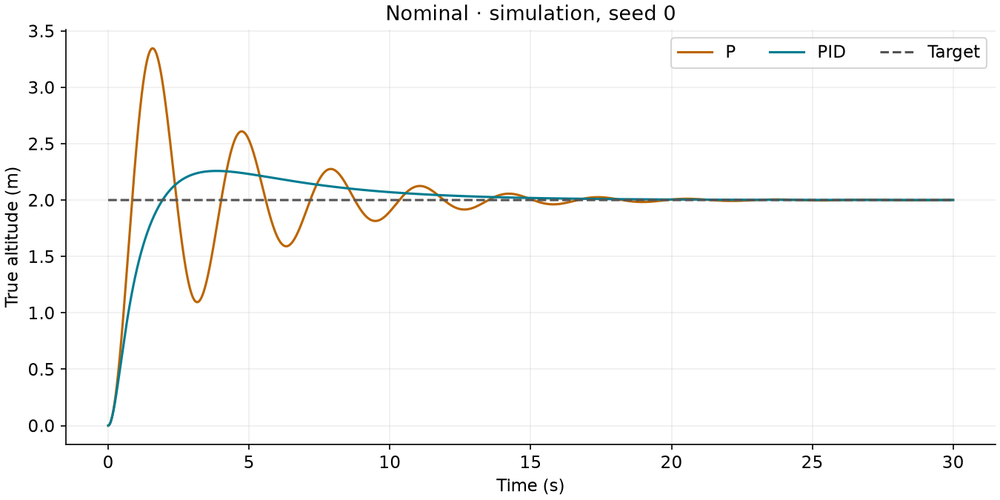
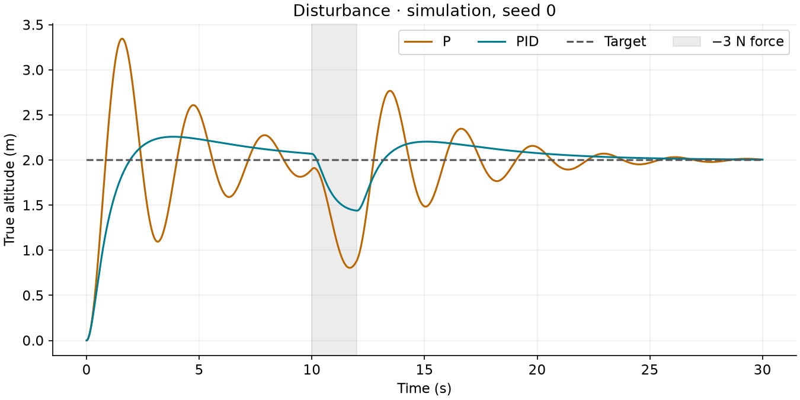
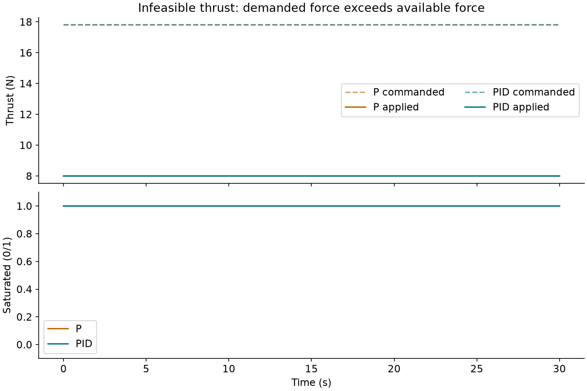
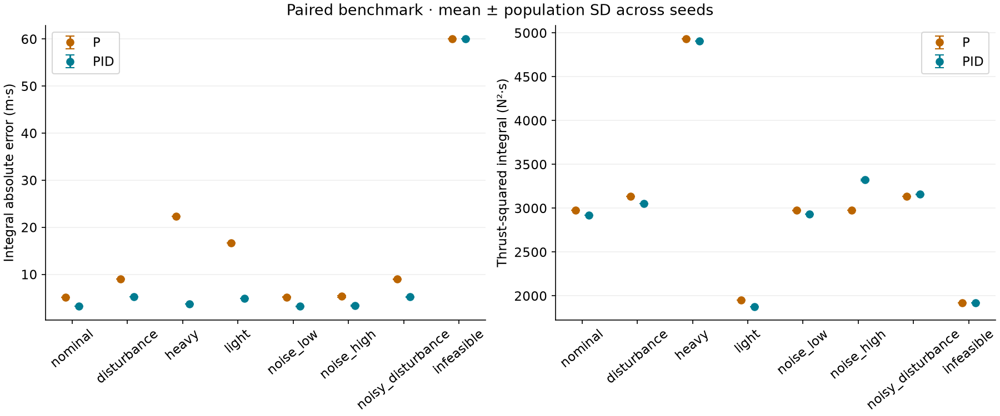
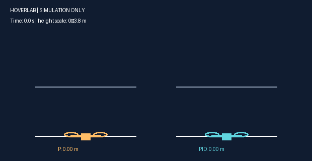
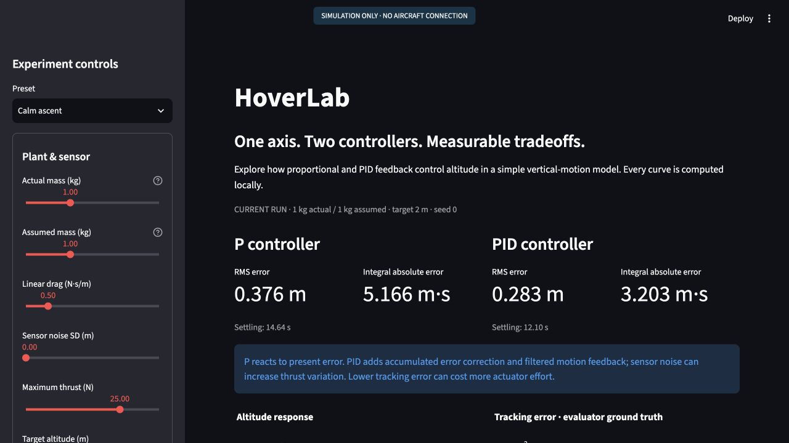
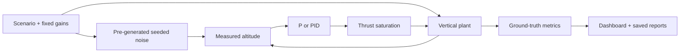

# HoverLab

**A software-only altitude-control laboratory. AI-assisted. No aircraft connection.**

Compare proportional control with filtered PID using a readable one-dimensional plant, an interactive dashboard, and reproducible paired experiments. This is an educational engineering portfolio project, not flight-control software or evidence of real-world validation.



## Run locally

Tested with **Python 3.14.3**. Use Python 3.14 for the pinned environment. After dependency installation, the app, tests, and experiments work offline.

```sh
python -m venv .venv
# macOS / Linux:
source .venv/bin/activate
# Windows PowerShell instead:
# .venv\Scripts\Activate.ps1
python -m pip install -r requirements.txt
python -m streamlit run app.py
```

Open the local URL printed by Streamlit, normally http://localhost:8501. GitHub hosts the source and reports, not a running Streamlit service.

```sh
python -m pytest -q
python -m hoverlab.benchmark --smoke
python -m hoverlab.benchmark
```

Smoke outputs go to ignored `work/smoke/`. The full command regenerates `results/`, the four PNG charts, animation, computed report and this results table. It does not tune gains. Optional `--output PATH` isolates reproduction output. Representative traces use seed 0; every run's metrics are retained.

## Measured simulation results

Fixed gains Kp=4, Ki=0.8, Kd=3.5, τ=0.1; P uses the same Kp. IAE is m·s, RMS is m, settling is s. Missing settling is not reached or N/A.

<!-- RESULTS_START -->

| scenario | controller | iae_mean | rms_mean | settling_s |
|---|---|---|---|---|
| nominal | P | 5.166 | 0.376 | 14.640 |
| nominal | PID | 3.203 | 0.283 | 12.100 |
| infeasible | P | 60.000 | 2.000 | not reached / N/A |
| infeasible | PID | 60.000 | 2.000 | not reached / N/A |

<!-- RESULTS_END -->

See the [generated full report](results/report.md), [all run metrics](results/metrics.csv), and [numerical sensitivity](results/sensitivity.csv). No claims about battery efficiency follow from the force-squared effort proxy. The infeasible case intentionally gives neither controller enough thrust to lift off. Results are conditional on this model and illustrative gains, not proof that PID always wins.








## How it works



The continuous model is `a = (u + F − m g − b v) / m`, with g=9.81 m/s², z in m, v in m/s, thrust u and external force F in N, mass m in kg, and linear drag b in N·s/m. Semi-implicit Euler applies `v[k+1]=v[k]+a[k] dt`, then `z[k+1]=z[k]+v[k+1] dt`. Default dt=0.01 s, duration=30 s, mass=1 kg, thrust limit=25 N, target=2 m. At ground penetration z is clamped to zero and downward velocity is zeroed (perfectly inelastic contact). Upward motion remains possible.

Both controllers know only measured altitude y, the reference r, nominal mass, gains and actuator limits. Actual mass and true velocity are hidden. Gravity feedforward is `m_nominal g`. With e=r−y, P commands `m_nominal g + Kp e`.

For PID, `d_raw=(y[k]−y[k−1])/dt`, `alpha=tau/(tau+dt)`, and `d[k]=alpha d[k−1]+(1−alpha)d_raw`. On the first sample d_raw=0 and d starts at zero. Derivative on measurement avoids a reference-step derivative kick. The candidate integral contribution is `I*=I+Ki e dt`. If the candidate command exceeds the upper limit with e>0 or lower limit with e<0, freeze I; otherwise accept I*. Then `u_cmd=m_nominal g+Kp e+I−Kd d`. Applied thrust clips this command to [0, u_max]. This conditional integration prevents error from winding the integrator farther into saturation; it is not a guarantee of stability for arbitrary gains.

Gain units: Kp N/m; Ki N/(m·s); Kd N·s/m; τ s; integral state I N. Both controllers begin with identical initial physical state and share exactly the same pre-generated noise samples. Evaluation uses true altitude, which the controllers never receive. Step metrics end before disturbances, and recovery is measured from force removal. See the [report](results/report.md) for precise metric definitions.

## Project map

- `hoverlab/physics.py`: parameter validation, force balance, ground contact.
- `hoverlab/controllers.py`: readable P/PID implementations.
- `hoverlab/simulation.py`: deterministic paired experiments.
- `hoverlab/metrics.py`: ground-truth evaluation.
- `hoverlab/benchmark.py`: saved results, plots, report generation.
- `hoverlab/visuals.py`: bounded animation from simulated data.
- `app.py`: dashboard and downloads.
- `configs/benchmark.json`: frozen gains, scenarios, seeds and predeclared sensitivity tolerance.
- `tests/`: physics, numerical behavior, fairness, metrics and UI checks.

## Limits, attribution and disclosure

This model omits tilt, motor dynamics, sensor latency, battery behavior and aerodynamic complexity. The animation is a visualization of simulated height. No hardware, users, awards, hackathon participation or personal learning outcomes are claimed. Codex assisted with implementation, tests, experiments and documentation; this repository should be described as **AI-assisted**. The code and reported runs should be understood and reviewed by anyone presenting it.

Controller conventions are informed by [MathWorks' anti-windup explanation](https://www.mathworks.com/help/simulink/slref/anti-windup-control-using-a-pid-controller.html) and [Åström and Murray's PID chapter](https://www.cds.caltech.edu/~murray/books/AM08/pdf/am08-pid_02Dec08.pdf). These sources motivate filtering and saturation handling; the code here is an independent educational implementation.

Read [the explanation](docs/explain.md), [60-second demo](docs/demo.md), [factual project summary](docs/project-summary.md) and [validation checklist](docs/checklist.md). Newly authored code is MIT licensed; dependencies retain their own licenses.
